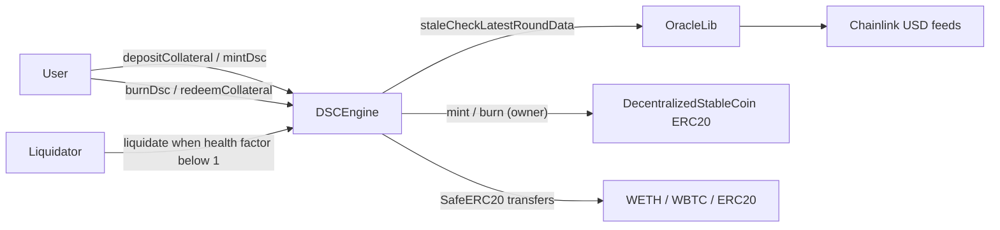

# Decentralized Stablecoin (DSC)

[](https://github.com/Phosah/defi-stablecoin/actions/workflows/test.yml)

An overcollateralized, USD-pegged stablecoin written in Solidity and tested with Foundry. Users lock crypto
collateral (WETH, WBTC, or any configured ERC20 with a Chainlink USD feed) and mint DSC against it. Positions that fall
below the required collateral ratio can be liquidated by anyone for a 10% bonus, keeping the system solvent.

> Built on top of the [Cyfrin Foundry DeFi Stablecoin](https://github.com/Cyfrin/foundry-defi-stablecoin-cu) course
> project by Patrick Collins, then hardened with the security improvements listed below.

- [Decentralized Stablecoin (DSC)](#decentralized-stablecoin-dsc)
- [How it works](#how-it-works)
  - [Architecture](#architecture)
  - [Key parameters](#key-parameters)
  - [User actions](#user-actions)
- [Improvements over the original](#improvements-over-the-original)
- [Getting Started](#getting-started)
  - [Requirements](#requirements)
  - [Quickstart](#quickstart)
- [Testing](#testing)
  - [Coverage](#coverage)
- [Deploy](#deploy)
  - [Local (Anvil)](#local-anvil)
  - [Sepolia](#sepolia)
  - [Interacting with cast](#interacting-with-cast)
- [Known limitations](#known-limitations)
- [Acknowledgements](#acknowledgements)
- [License](#license)

# How it works

DSC has three properties:

1. **Exogenously collateralized:** backed by external crypto assets, not by DSC itself.
2. **Dollar pegged:** 1 DSC is designed to be worth $1.
3. **Algorithmically stable:** there's no governance. Minting is only possible while a user stays overcollateralized,
   and anyone can liquidate unhealthy positions.

It is similar to MakerDAO's DAI with no governance, no fees, and a fixed set of collateral types.

## Architecture



| Contract | Role |
| --- | --- |
| [`src/DSCEngine.sol`](src/DSCEngine.sol) | Core logic: collateral accounting, minting, burning, health factor, liquidation |
| [`src/DecentralizedStableCoin.sol`](src/DecentralizedStableCoin.sol) | ERC20 `DSC` token; only its owner (the engine) can mint and burn |
| [`src/libraries/OracleLib.sol`](src/libraries/OracleLib.sol) | Chainlink wrapper that reverts on stale (over 3h) or non-positive prices |
| [`script/DeployDSC.s.sol`](script/DeployDSC.s.sol) | Deploys DSC and the engine, then hands DSC ownership to the engine |
| [`script/HelperConfig.s.sol`](script/HelperConfig.s.sol) | Per-network config; deploys mocks on Anvil |

## Key parameters

| Parameter | Value | Meaning |
| --- | --- | --- |
| Liquidation threshold | 50% | Collateral must be worth at least 200% of debt |
| Liquidation bonus | 10% | Liquidators receive $110 of collateral per $100 of debt repaid |
| Min health factor | 1e18 | `healthFactor = (collateralUsd * 50%) * 1e18 / debt` |
| Oracle timeout | 3 hours | Older prices freeze the protocol by design |

## User actions

- `depositCollateral` / `depositCollateralAndMintDsc`: lock collateral, optionally minting DSC in the same transaction.
- `mintDsc`: mint DSC, reverting if the health factor would drop below 1.
- `burnDsc`: repay debt.
- `redeemCollateral` / `redeemCollateralForDsc`: withdraw collateral, optionally repaying DSC in the same transaction.
- `liquidate(collateral, user, debtToCover)`: repay part or all of an unhealthy user's debt and receive their
  collateral plus a 10% bonus.

# Improvements over the original

| Area | Change |
| --- | --- |
| Oracle safety | `OracleLib` reverts with `OracleLib__InvalidPrice` on zero or negative answers, which were previously cast to `uint256` unchecked |
| Token decimals | Token and feed decimals are read and cached at construction, and all USD math is normalized to 18 decimals. Real 8-decimal WBTC, 6-decimal stablecoins, and 18-decimal feeds are now valued correctly; the original assumed 18-decimal tokens and 8-decimal feeds |
| Non-standard ERC20s | Collateral transfers use OpenZeppelin `SafeERC20`, so USDT-style tokens that return no value work |
| Reentrancy | `nonReentrant` added to `redeemCollateralForDsc` and `burnDsc` |
| Constructor validation | Reverts on a zero DSC, token, or feed address, on duplicate collateral tokens, and on decimals above 18 |
| Observability | New `DscMinted`, `DscBurned`, and `Liquidated` events |
| Views | New `getDscMinted`, `getTokenDecimals`, and `getFeedDecimals` |
| Deploy config | The Sepolia WBTC address pointed at a contract that doesn't exist on Sepolia. The config now uses `SEPOLIA_WBTC_ADDRESS` if set, and otherwise deploys an 8-decimal test WBTC |
| CI | GitHub Actions workflow running `forge build --sizes` and `forge test` |

# Getting Started

## Requirements

- [git](https://git-scm.com/book/en/v2/Getting-Started-Installing-Git)
- [foundry](https://getfoundry.sh/): check that `forge --version` works

## Quickstart

```bash
git clone --recurse-submodules https://github.com/Phosah/defi-stablecoin
cd defi-stablecoin
forge build
```

If you cloned without `--recurse-submodules`, run `git submodule update --init --recursive`.

# Testing

```bash
forge test
```

The suite contains:

- **Unit tests** in [`test/unit`](test/unit) covering the engine, token, and oracle library, including constructor
  validation, events, and failure paths.
- **Decimals tests** in [`test/unit/DSCEngineDecimalsTest.t.sol`](test/unit/DSCEngineDecimalsTest.t.sol): 8-decimal
  WBTC, a 6-decimal no-return token, an 18-decimal feed, a full mint-then-liquidate flow with 8-decimal collateral, and
  fuzz tests for USD round-trip rounding and for minting never succeeding below the minimum health factor.
- **Invariant tests** in [`test/fuzz`](test/fuzz): the protocol must always hold more collateral value than the total
  DSC supply, and getters must never revert.

## Coverage

```bash
forge coverage --report summary
```

| File | Lines | Branches |
| --- | --- | --- |
| `src/DSCEngine.sol` | 98.6% | 91.7% |
| `src/DecentralizedStableCoin.sol` | 100% | 100% |
| `src/libraries/OracleLib.sol` | 100% | 100% |

# Deploy

## Local (Anvil)

```bash
make anvil          # terminal 1
make deploy         # terminal 2
```

## Sepolia

1. Copy `.env.example` to `.env` and fill in `SEPOLIA_RPC_URL`, `PRIVATE_KEY`, and `ETHERSCAN_API_KEY`.
   **Use a key with no real funds.**
2. Optionally set `SEPOLIA_WBTC_ADDRESS` to an existing 8-decimal WBTC token. If it's unset, a test WBTC is deployed.
3. Get Sepolia ETH from [faucets.chain.link](https://faucets.chain.link/).
4. Deploy and verify:

```bash
make deploy ARGS="--network sepolia"
```

## Interacting with cast

```bash
# Wrap ETH into Sepolia WETH
cast send 0xdd13E55209Fd76AfE204dBda4007C227904f0a81 "deposit()" --value 0.1ether --rpc-url $SEPOLIA_RPC_URL --private-key $PRIVATE_KEY

# Approve the engine
cast send 0xdd13E55209Fd76AfE204dBda4007C227904f0a81 "approve(address,uint256)" <DSC_ENGINE> 100000000000000000 --rpc-url $SEPOLIA_RPC_URL --private-key $PRIVATE_KEY

# Deposit 0.1 WETH and mint 10 DSC
cast send <DSC_ENGINE> "depositCollateralAndMintDsc(address,uint256,uint256)" 0xdd13E55209Fd76AfE204dBda4007C227904f0a81 100000000000000000 10000000000000000000 --rpc-url $SEPOLIA_RPC_URL --private-key $PRIVATE_KEY

# Check your health factor
cast call <DSC_ENGINE> "getHealthFactor(address)(uint256)" <YOUR_ADDRESS> --rpc-url $SEPOLIA_RPC_URL
```

# Known limitations

- **Insolvency:** if collateral prices crash faster than liquidations happen and a position drops below 110%
  collateralization, the liquidation bonus can't be paid, so the position can't be liquidated.
- **Oracle freeze:** stale or invalid Chainlink prices freeze the engine. This is intentional, but it also blocks
  repayments and withdrawals.
- **Fee-on-transfer and rebasing tokens** are not supported as collateral.
- This code has not been professionally audited. Do not use it with real funds.

# Acknowledgements

- Original design and code: [Patrick Collins](https://github.com/PatrickAlphaC) and the
  [Cyfrin Updraft](https://updraft.cyfrin.io/) Foundry course
  ([original repo](https://github.com/Cyfrin/foundry-defi-stablecoin-cu)).
- [OpenZeppelin Contracts](https://github.com/OpenZeppelin/openzeppelin-contracts) and
  [Chainlink](https://github.com/smartcontractkit/chainlink-brownie-contracts).

# License

[MIT](LICENSE)
